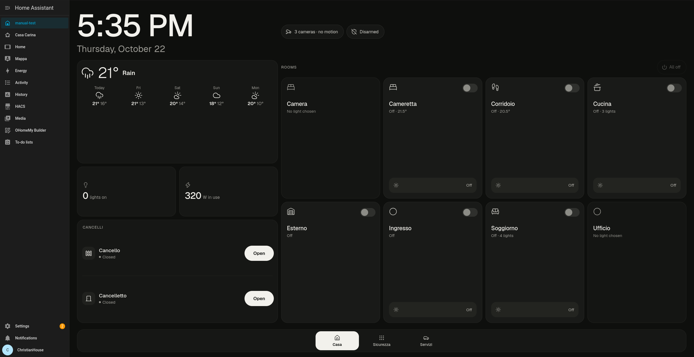
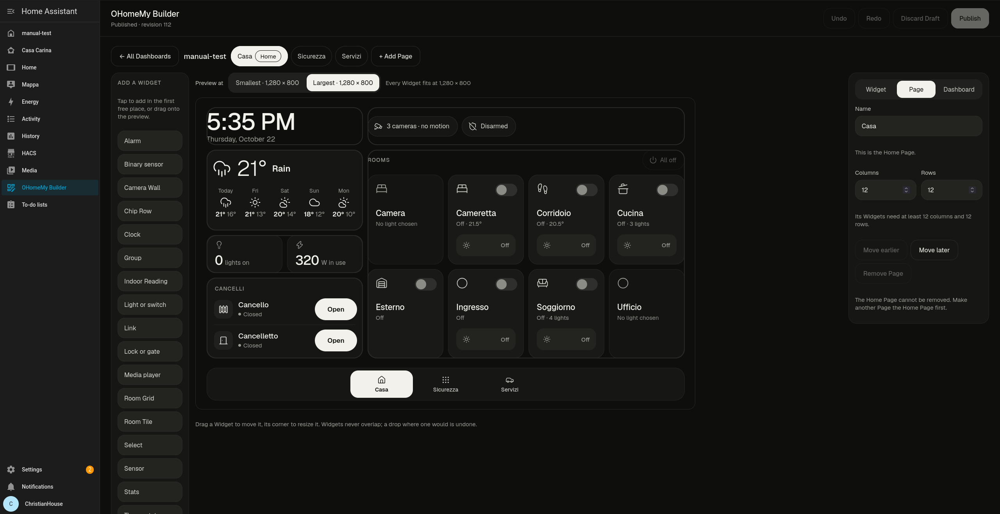
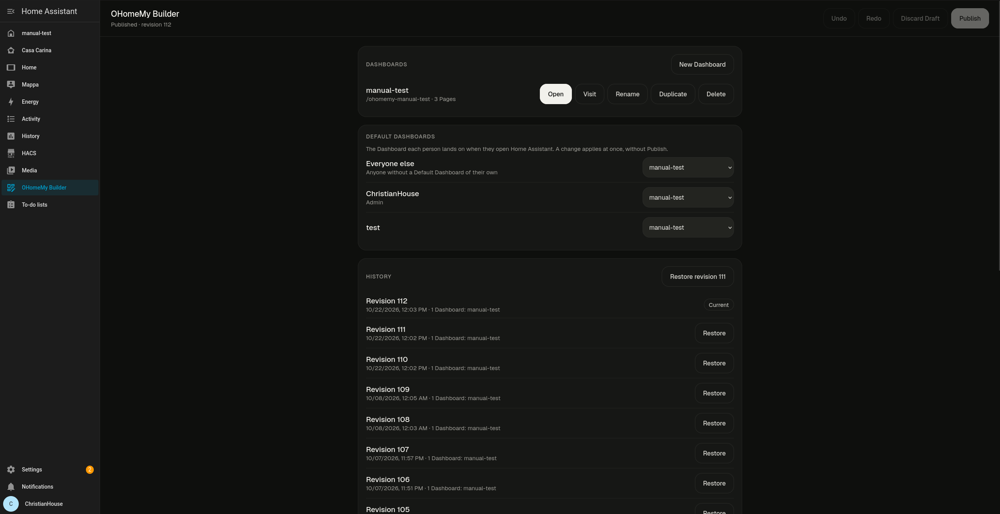

# OHomeMy

[](https://my.home-assistant.io/redirect/hacs_repository/?owner=vallops99&repository=OHomeMy&category=integration)
[](https://my.home-assistant.io/redirect/config_flow_start/?domain=ohomemy)

## What OHomeMy is

OHomeMy is a Home Assistant integration for building house Dashboards
graphically. An admin lays out any number of Dashboards in the Builder, by
dragging Widgets onto a live preview, and each Dashboard is a panel inside
Home Assistant that any user can open or have as their Default Dashboard.



The Builder edits a Page with an Add a Widget list, a live preview and an
inspector for the chosen Widget:



It needs Home Assistant **2026.9.0** or newer and HACS **2.0.0** or newer.

## How it works

- The **Builder** is an admin-only panel. Each Dashboard is a panel of its own,
  which can be shown in the sidebar.
- Your edits go into a **Draft**, which nobody else sees. **Undo** and
  **Redo** work inside a Draft.
- **Publish** makes the Draft what every open Dashboard shows. It is refused
  if someone else Published since your Draft began.
- **History** lists every Publish. **Restore** Publishes an earlier one again,
  so History only grows.
- A **Default Dashboard** is the Dashboard a user lands on when they open Home
  Assistant. Set one per user, or one for "Everyone else", in the Builder.
  Default Dashboards apply at once, without a Publish.
- The layout is stored by the integration in Home Assistant's own storage, not
  in a file you have to manage. See
  [ADR-0015](docs/adr/0015-ohomemy-a-builder-owns-the-layout.md) and
  [layout storage](docs/research/layout-storage.md).



For the full vocabulary see [CONTEXT.md](CONTEXT.md); for the decisions behind
it see [docs/adr/](docs/adr/).

## Install through HACS

1. Click the "Open in HACS" badge above, or do it by hand in HACS 2.x: open the
   ⋮ menu, choose **Custom repositories**, add
   `https://github.com/vallops99/OHomeMy` with the type **Integration**.
2. Find OHomeMy in HACS and choose **Download**.
3. Restart Home Assistant.

## Set it up

Go to **Settings → Devices & services → Add integration → OHomeMy**, or click
the "Add integration" badge above. There is nothing to configure: OHomeMy
allows a single config entry, so adding it is the whole setup.

It adds the Builder panel (admins only) and two entities:

- `select.ohomemy_popup` is which Popup is open, house-wide. Its options are
  `none` followed by every Popup name across all Dashboards, sorted. Select a
  name to open that Popup; select `none` to close it. Every Dashboard that has
  a Page for that name shows it, and closing it on one closes it on all. A
  Popup that is open across a restart stays open, unless no Dashboard defines
  its name any more, in which case it is closed.
- `button.ohomemy_popup_activity` marks the open Popup as in use. A Popup never
  closes on its own, and Home Assistant cannot see touches, so the panel presses
  this button (at most every few seconds) while someone touches an open Popup.
  Pressing does nothing else: the button's state is the time of the last press.

Open a Popup from an automation by selecting its name:

```yaml
automation:
  - alias: Show the doorbell Popup
    triggers:
      - trigger: state
        entity_id: binary_sensor.front_door_ring
        to: "on"
    actions:
      - action: select.select_option
        target:
          entity_id: select.ohomemy_popup
        data:
          option: Doorbell
```

To close it after a quiet spell, wait for the activity button's state to change
and select `none` when nothing happens for a while:

```yaml
automation:
  - alias: Close the Popup after a quiet spell
    triggers:
      - trigger: state
        entity_id: select.ohomemy_popup
        not_to: none
    actions:
      - wait_for_trigger:
          - trigger: state
            entity_id: button.ohomemy_popup_activity
        timeout: "00:02:00"
        continue_on_timeout: true
      - if:
          - condition: template
            value_template: "{{ wait.trigger is none }}"
        then:
          - action: select.select_option
            target:
              entity_id: select.ohomemy_popup
            data:
              option: none
```

## Use it once installed

1. Open **OHomeMy Builder** from the sidebar (admins only) and add a Dashboard.
2. Add Pages to it, and pick one as its Home Page. Give a Page a Popup name to
   make it a Popup.
3. Add Widgets to a Page from the Add a Widget list, then place and size them
   on the live preview and set each one in the inspector.
4. **Publish** the Draft when you are happy. Use **Restore** in History to go
   back to an earlier Publish.
5. Set a Default Dashboard for a user, or for "Everyone else".

### Widgets

- **Room Tile**: an Area, with how many of its lights are on, its temperature,
  and a switch for its chosen light.
- **Room Grid**: a set of Room Tiles under one title, with a control that turns
  off every light in them.
- **Group**: an ordered set of entities of any mix of Domains under one title.
- **Light or switch**: one light or switch, with a dimmer where it can dim.
- **Lock or gate**: a lock, opened by holding so a stray tap cannot open it.
- **Thermostat**: a climate entity, with its setpoint and modes.
- **Alarm**: an alarm panel, with the arm modes it supports.
- **Media player**: a player, with the controls it supports.
- **Vacuum**: a vacuum, with its state, battery, start, pause and dock.
- **Weather**: the condition now, the temperature and the days ahead.
- **Sensor** and **Binary sensor**: one reading, read only.
- **Select**: a select entity's current option, with a picker for the rest.
- **Clock**: the time and date in the viewer's own formats.
- **Indoor Reading**: one temperature big enough to read on approach, with an
  optional humidity under it.
- **Stats**: an icon over one big number, such as how many lights are on.
- **Camera Wall**: one big Feed beside a strip of thumbnails of the other
  cameras.
- **Chip Row**: a row of chips for Faults, open ways in, cameras and the alarm.
- **Link**: opens a Page when tapped, and does nothing else.

A Dashboard can also have a **Navbar**, its own bar of destinations along one
edge of every Page, with a Page and an icon for each item.

## Wall tablet tip

For a dedicated wall tablet:

1. Create a non-admin Home Assistant user for the tablet.
2. In the Builder, set that user's Default Dashboard.
3. In that user's Home Assistant profile, turn on **Always hide the sidebar**.
4. In Fully Kiosk (or a similar app), turn **suspend when hidden** off and point
   the start URL at `/`.

## Troubleshooting and support

If something does not work, or you have a question, open an issue at
<https://github.com/vallops99/OHomeMy/issues>.
